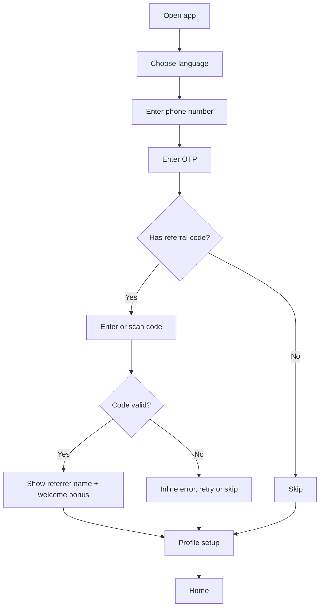
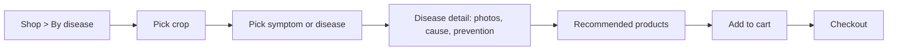
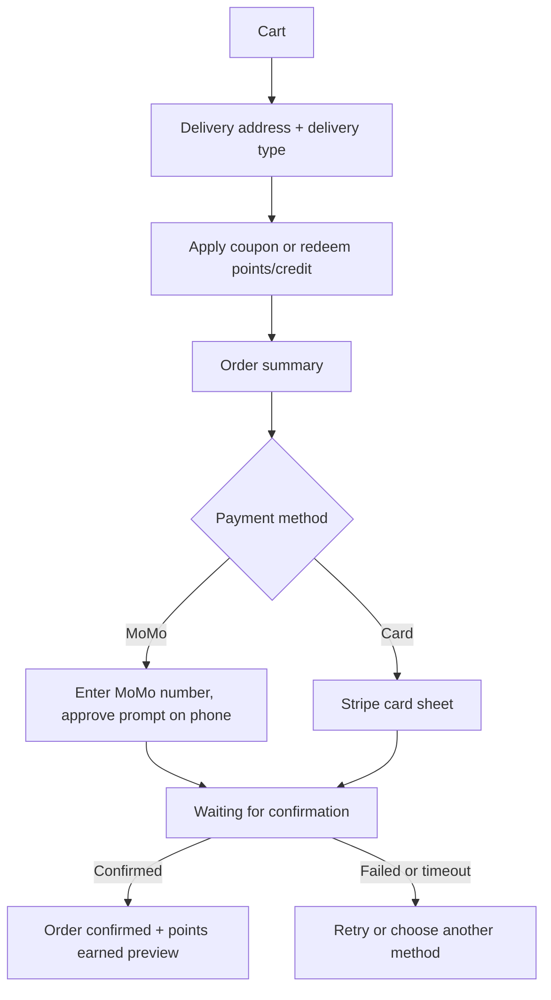
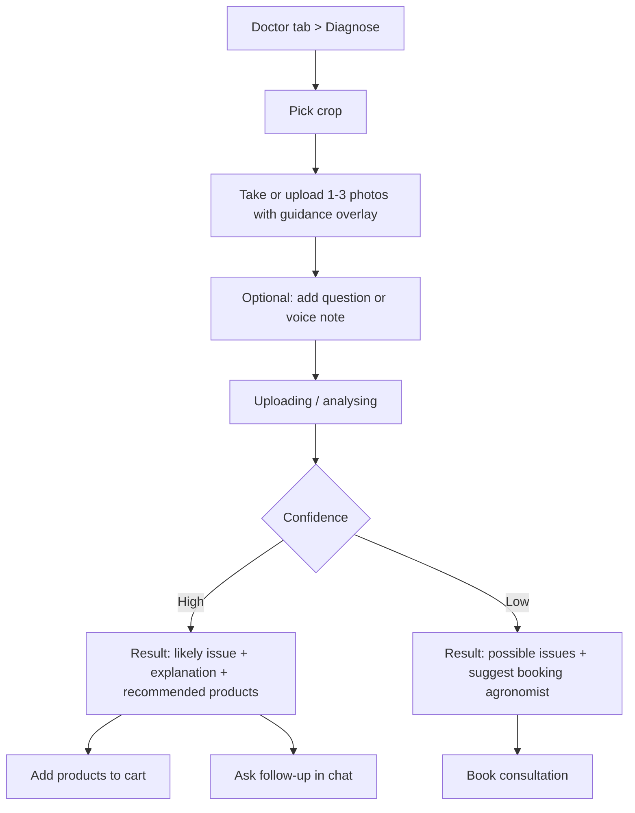

# Agro Hospital Farmer App: System Analysis for UI Build

**Version:** 1.0 | **Date:** 5 November 2026 | **Platform:** Android first (Flutter recommended) | **Languages:** English, French
**Audience:** UI/UX designers and mobile developers
**Related documents:** Project Proposal AH-DP-2026-001

---

## 1. Purpose and scope

The Agro Hospital app lets farmers and cooperatives in Cameroon buy agricultural inputs (pesticides, fungicides, herbicides, fertilisers, bio-stimulants, seeds, equipment), book agronomist consultations, get AI-based crop diagnosis from photos, and earn loyalty points and referral credit.

This document translates the business analysis into what a designer and developer need to build the UI: users, navigation, screens, components, states, business rules that affect the interface, and data the screens display.

### 1.1 Product goals that drive UI decisions

1. A farmer can go from "my crop is sick" to "product ordered" in the fewest taps possible.
2. The app must work on low-end Android phones (Android 8+) and unstable networks.
3. Text-light, icon-led screens, because digital literacy varies.
4. Loyalty and referral value must always be visible, to bring farmers back.
5. Trust: show agronomist expertise, product safety information and real delivery status.

### 1.2 Phasing (UI delivery order)

| Phase | Modules |
|---|---|
| 1. Commerce core | Onboarding and accounts, catalogue, cart and checkout, orders, loyalty, referrals, delivery tracking, notifications |
| 2. Engagement and support | Live chat, consultations, learning feed, campaigns and workshops, weather, language, offline mode |
| 3. AI Crop Doctor | Camera diagnosis, AI chat, history, escalation to consultation |

---

## 2. Users and personas

| Persona | Description | UI implications |
|---|---|---|
| **Smallholder farmer** | Family farm, mid-range or low-end Android, intermittent data, may prefer French or English, limited typing | Big buttons, icons, minimal forms, offline use, short sentences |
| **Cooperative manager** | Orders for many members, bigger baskets, repeat purchases | Reorder, order history, saved addresses, multiple delivery locations |
| **Field marketer / employee** | Registers farmers, shares referral code | Own referral code and stats, assisted sign-up |
| **Diaspora investor** | Owns land remotely, pays by card | Stripe checkout, English/French, delivery to a farm address |

Staff-facing screens (CRM, logistics, chat console, AI training) live in the existing management system and are outside this UI scope, except where the app depends on them (Section 10).

---

## 3. Navigation and information architecture

### 3.1 Bottom navigation (5 tabs)

```
[ Home ]  [ Shop ]  [ Doctor ]  [ Learn ]  [ Account ]
```

| Tab | Purpose |
|---|---|
| **Home** | Dashboard: weather, active order, points, campaigns, quick actions |
| **Shop** | Catalogue by category or disease, search, cart |
| **Doctor** | AI Crop Doctor, consultations (Phase 3 for AI; consultations Phase 2) |
| **Learn** | Articles, workshops, campaigns |
| **Account** | Profile, orders, wallet (points and credit), referrals, chat, settings |

Persistent floating **Chat** shortcut on Home, Shop and Order screens. Cart icon with badge in the top bar of Shop screens.

### 3.2 Screen map

```
Splash
 ├─ Language select
 ├─ Onboarding carousel (3 slides, skippable)
 └─ Auth
     ├─ Phone number entry
     ├─ OTP verification
     ├─ Referral code (optional)
     └─ Profile setup (name, region, crops, farm type)

Main (tabs)
 ├─ Home
 │   ├─ Weather detail
 │   ├─ Active order tracker
 │   └─ Notifications inbox
 ├─ Shop
 │   ├─ Category list → Product list → Product detail
 │   ├─ Disease list → Disease detail → Recommended products
 │   ├─ Search (with filters)
 │   ├─ Cart
 │   └─ Checkout → Payment → Order confirmation
 ├─ Doctor
 │   ├─ AI Crop Doctor (camera, chat, result, history)
 │   ├─ Consultations (list, book, detail)
 │   └─ Consultation booking flow
 ├─ Learn
 │   ├─ Feed (articles, guides, product info)
 │   ├─ Article detail
 │   ├─ Campaigns and discounts
 │   └─ Workshops (list, detail, register)
 └─ Account
     ├─ Profile and addresses
     ├─ My orders → Order detail → Track delivery → Rate delivery
     ├─ Wallet (loyalty points, referral credit, history, redeem)
     ├─ Referrals (my code, share, referred farmers, earnings)
     ├─ Chat with Agro Hospital
     ├─ Language
     ├─ Offline and data settings
     └─ Help, terms, privacy, logout
```

---

## 4. Key user flows

### 4.1 Sign-up with or without referral code



Rules: code can be entered once, only at sign-up or within 7 days after (configurable). Self-referral is blocked. Show a clear, friendly message on invalid or already-used codes.

### 4.2 Disease to purchase



### 4.3 Checkout and payment



Rules: order is confirmed only after the gateway callback, never on the button tap. If the app closes during payment, the order screen shows "Payment pending" until resolved.

### 4.4 Delivery tracking and feedback

Order status timeline: **Confirmed, Packed, Dispatched, In transit, Delivered** (plus Cancelled, Failed).
- In-town (own rider): live map with rider position, ETA, call rider button.
- Out-of-town (third-party courier): timeline only, with courier name, waybill number and last update.
- On delivery: farmer enters the delivery OTP to the rider, then gets a rating prompt (1 to 5 stars, quick tags, optional comment).

### 4.5 AI Crop Doctor



Always show the disclaimer: "AI guidance, not a guarantee". Offline: photos are saved and sent when the connection returns, with a pending state.

### 4.6 Consultation booking

Pick service (consultation, soil test, plant/leaf analysis, water test, farm visit) → choose mode (online or on-site) → pick agronomist (optional) → pick date and time slot → confirm → reminder set. Detail screen shows status (requested, confirmed, completed, cancelled), agronomist notes and recommended products after completion.

### 4.7 Referral and loyalty redemption

- Referral: Account > Referrals > Share code (WhatsApp, SMS, copy, QR) > see referred farmers and credit earned.
- Redemption: at checkout, a toggle "Use points / credit" shows the amount applied. Points and credit can only reduce product payment; no cash-out option anywhere in the UI.

---

## 5. Screen specifications

Legend: **S** = screen, states listed as Default / Loading / Empty / Error / Offline where relevant. Phase in brackets.

### 5.1 Onboarding and accounts [Phase 1]

| ID | Screen | Components | Actions | States and notes |
|---|---|---|---|---|
| S01 | Splash | Logo, spinner | Auto-route | Check session and language |
| S02 | Language select | Two large cards (English, Français) | Select | Persist; changeable later |
| S03 | Onboarding carousel | 3 illustrated slides, Skip, Next | Skip, Next, Get started | Slides: shop, diagnose, earn rewards |
| S04 | Phone entry | Country code (+237 default), phone field, Continue | Send OTP | Validate length; error for invalid number |
| S05 | OTP | 6-digit input, resend timer, change number | Verify, Resend | Auto-read SMS where possible; error and lockout states |
| S06 | Referral code | Code field, scan QR, Skip | Apply, Skip | Valid shows referrer's first name; invalid inline error |
| S07 | Profile setup | Name, region (list), crops (multi-chip), farm type (smallholder, cooperative, plantation, investor) | Save | Minimal required fields (name, region) |

### 5.2 Home [Phase 1, extended later]

| ID | Screen | Components | Notes |
|---|---|---|---|
| S10 | Home | Greeting, weather card, **active order card**, points balance chip, quick actions (Shop, Diagnose, Book expert, Chat), campaign banner carousel, "Today's tip" article card | Cards load independently; skeletons while loading; works with cached data offline |
| S11 | Weather detail | Today, 7-day forecast, rain probability, farming advisory text | Needs farm location (set in profile); offline shows last cached forecast with timestamp [Phase 2] |
| S12 | Notifications inbox | List grouped by date (orders, promotions, reminders, chat) | Mark read; deep links to target screen |

### 5.3 Shop [Phase 1]

| ID | Screen | Components | Actions | States and notes |
|---|---|---|---|---|
| S20 | Shop home | Search bar, toggle **By category / By disease**, category grid, featured and promo products | Switch mode, search | Offline: cached catalogue with "last updated" label |
| S21 | Category list | Icon tiles: Insecticides, Fungicides, Herbicides, Fertilisers, Bio-stimulants, Seeds, Equipment | Tap tile | Counts per category |
| S22 | Product list | Product cards (image, name, size, price, points earned, stock badge), filters (crop, price, brand), sort | Add to cart, open detail | Empty, loading skeleton, pagination |
| S23 | Product detail | Image gallery, name, price, **points earned**, stock, tabs: Description / Usage and dosage / Safety / Related articles; "Used for" disease chips; Add to cart; Ask expert | Add to cart, Ask in chat, Book consultation, Share | Safety tab prominent for chemicals (PPE, pre-harvest interval, warnings). Restricted products show "Agronomist approval required" and a request button |
| S24 | Disease picker | Crop chips, symptom search, disease cards with photo | Select | Starts from crop to reduce choices |
| S25 | Disease detail | Photos, symptoms, cause, prevention, **recommended products** list, "Not sure? Diagnose with AI" | Add recommended products, Diagnose | Links to learning articles |
| S26 | Search | Query, recent searches, suggestions across products, diseases, articles | Tap result | Supports French and English terms |
| S27 | Cart | Line items (qty stepper, remove), subtotal, points to earn, coupon field, Checkout | Edit, Apply coupon | Empty state with Shop button; persisted offline |
| S28 | Checkout | Address selector, delivery type (auto: in-town or out-of-town, shows fee and estimate), coupon, points/credit toggle, summary, payment method selector (MoMo, Card) | Place order | Validation, price recalculation if stock changes |
| S29 | Payment waiting | MoMo instruction ("Approve the prompt on your phone"), timer, status | Cancel, Retry | Handles timeout, failure, success |
| S30 | Order confirmation | Success animation, order number, points earned (pending until delivery), Track order, Continue shopping | Track | |

### 5.4 Orders, delivery and rewards [Phase 1]

| ID | Screen | Components | Notes |
|---|---|---|---|
| S40 | My orders | Tabs: Active / Past; order cards (number, date, status chip, total) | Pull to refresh; reorder button on past orders |
| S41 | Order detail | Status timeline, items, address, payment status, totals, points earned/used, Help (opens chat with order context) | Cancel allowed only before Dispatched |
| S42 | Track delivery | Map (in-town) or timeline (out-of-town), rider/courier info, ETA, call button, delivery OTP card | Map only for own riders |
| S43 | Rate delivery | Stars, quick tags (on time, careful handling, polite), comment | Shown after Delivered; skippable |
| S44 | Wallet | Two balances: **Loyalty points** and **Referral credit**, history list (earned, used, expired), redeem info | Points show expiry date if enabled |
| S45 | Referrals | My code (large), Share buttons, QR code, list of referred farmers (first name, status, orders), credit earned, rules link | Credit pending until referred order delivered |
| S46 | Profile and addresses | Name, phone, region, crops, farm location (map pin), saved addresses | Delivery type depends on address region |

### 5.5 Engagement and support [Phase 2]

| ID | Screen | Components | Notes |
|---|---|---|---|
| S50 | Chat list / thread | Conversation with Agro Hospital, department tag, text, images, order or product attachment cards, typing and delivered ticks | Messages queue offline and show "Sending"; context banner when opened from an order |
| S51 | Consultations list | Upcoming and past, status chips, Book button | Reminder indicators |
| S52 | Book consultation | Step form: service, mode, date and time, notes and photos, summary | Slots from management system; confirmation screen |
| S53 | Consultation detail | Status, agronomist, schedule, notes, recommended products, reschedule/cancel | Add-to-cart for recommended products |
| S60 | Learn feed | Search, category chips (Guides, How-tos, Product info, News), article cards | Cached articles readable offline; "Download for offline" |
| S61 | Article detail | Hero image, title, author, body, related products, share | Product cards inside article link to S23 |
| S62 | Campaigns and discounts | Active campaign cards with coupon code and expiry | Copy code, apply at checkout |
| S63 | Workshops | Upcoming list, date, place, spots left | Register, add reminder; registered state |
| S70 | Language settings | English, Français | Applies instantly |
| S71 | Offline and data settings | Offline content toggle, Wi-Fi-only downloads, clear cache, image quality (low / normal) | Shows storage used |

### 5.6 AI Crop Doctor [Phase 3]

| ID | Screen | Components | Notes |
|---|---|---|---|
| S80 | Doctor home | Big "Diagnose a plant" button, recent diagnoses, "Talk to an agronomist" | |
| S81 | Camera | Crop picker, camera view with guidance overlay (frame the affected leaf, good light), gallery upload, 1 to 3 photos | Permission request screen with plain-language explanation; compress image before upload |
| S82 | Analysing | Progress state, "You can leave this screen, we will notify you" | Offline: saved and queued |
| S83 | Result | Photo, likely issue(s) with confidence band (high / possible), explanation, steps to take, **recommended products** with Add to cart, disclaimer, buttons: Ask follow-up, Book agronomist | Low confidence leads with "Book an agronomist" |
| S84 | AI chat | Text and photo messages, suggestion chips | Responses grounded in company knowledge; product cards inline |
| S85 | Diagnosis history | List with photo, crop, date, result | Re-open results |

---

## 6. Business rules that affect the UI

### 6.1 Loyalty points
- Each product has its own points value set in the management system; the app shows **"Earn X points"** on product cards, detail, cart and confirmation.
- Points are credited only after delivery (show "Pending" in wallet until then).
- Points redeem against product payment only. Optional expiry shown in wallet.

### 6.2 Referral credit
- Farmers, field marketers and employees each have a code; rates can differ.
- Credit accrues on referred farmers' orders once delivered and past the return window.
- Credit is redeemable **only as product value**, no withdrawal. Wording in UI: "Referral credit (use on products)".
- Anti-fraud messaging: show friendly errors, never expose detection logic.

### 6.3 Coupons
- Types: percentage, fixed amount, product-specific, first order, time-limited.
- Show validity, minimum basket and clear rejection reasons ("Expired", "Minimum order not reached").

### 6.4 Delivery
- Address region decides **in-town** (own riders, live map) or **out-of-town** (third-party courier, timeline only).
- Fees and estimated time are shown before payment.
- Delivery OTP is shown to the farmer and given to the rider on handover.

### 6.5 Regulated and restricted products
- Chemicals display safety information (PPE, pre-harvest interval, storage) before Add to cart on first purchase.
- Restricted products cannot be added to cart without agronomist approval; the UI offers "Request approval" which opens a consultation or chat with the product attached.

### 6.6 Payments
- MoMo: user approves the prompt on their phone; app polls and listens for confirmation.
- Card: Stripe payment sheet; no card data stored by the app.
- Never mark an order as paid from the client side.

---

## 7. Offline and low-bandwidth behaviour

| Capability | Offline behaviour |
|---|---|
| Browse catalogue | Cached products, categories, diseases; show "Last updated" label |
| Read articles | Cached and downloaded articles readable |
| Cart | Persisted locally; price re-validated when online |
| Orders and payment | Needs connection; order screen shows last known status |
| Chat | Messages queue, show Sending and Sent states |
| Consultation booking | Request queued, "Pending sync" until confirmed |
| Diagnosis | Photos queued and uploaded later |
| Weather | Last cached forecast with timestamp |
| Sync | Automatic on reconnect; manual Refresh in Settings; conflict messages in plain language |

Global indicators: slim banner "You are offline. Some features are limited." and a small "Syncing" indicator when queued actions are sent.

Performance targets: install size under 30 MB, cold start under 3 seconds on entry-level phones, images compressed and lazy-loaded, list pagination, skeleton loaders instead of spinners.

---

## 8. Design guidelines

### 8.1 Brand and visual direction
Agricultural, trustworthy, clean. Green-led palette matching the proposal and website tone.

| Token | Value | Use |
|---|---|---|
| `primary` | `#1B4D2E` | App bars, primary text accents |
| `primary-mid` | `#2F7D45` | Buttons, active tab |
| `accent` | `#8DC63F` | Highlights, success, points |
| `earth` | `#C98A1B` | Warnings, promotions, pending |
| `surface` | `#F7F3E8` | Backgrounds, cards |
| `surface-light` | `#EEF5E9` | Section tints |
| `danger` | `#C0392B` | Errors, restricted products |
| `text` | `#222222` | Body |
| `text-muted` | `#555555` | Secondary |

Confirm against the existing Agro Hospital logo and brand assets before finalising.

### 8.2 Typography and layout
- One clean sans-serif family (e.g. Inter or Roboto), minimum body size 16 sp, buttons 16 to 18 sp.
- 8 dp spacing grid, minimum touch target 48 dp, generous spacing between actions.
- Primary action per screen is a full-width button anchored at the bottom.

### 8.3 Components to design once and reuse
App bar, bottom nav with badge, search field, category tile, product card, disease card, price and points tag, quantity stepper, status chip and timeline, address card, payment method selector, coupon field, wallet balance card, referral code card with share row, article card, campaign banner, workshop card, chat bubble (text, image, product, order), consultation slot picker, rating stars with tags, empty state, error state, offline banner, skeleton loader, permission explainer sheet, disclaimer banner.

### 8.4 Accessibility and inclusion
- Icon plus text labels (never icon only), high contrast (WCAG AA).
- Support system font scaling up to 130%.
- Plain-language copy, short sentences, numerals with currency **XAF** formatted as `12 500 XAF`.
- Text expansion allowance for French (about 30% longer than English).
- Optional image-based help: short illustrated steps for first-time actions.
- Prepare for future audio and local-language support (design space for a "listen" button on articles and results).

### 8.5 Content and tone
Friendly, respectful, practical. Examples: "Your order is on the way", "Take a clear photo of the affected leaf", "Always wear gloves and a mask when applying". Avoid technical jargon unless explained.

---

## 9. Data entities the UI displays

| Entity | Key fields shown in UI |
|---|---|
| **User** | id, name, phone, region, crops, farm type, language, farm location, referral code, referred_by |
| **Address** | label, region, town, details, coordinates, delivery_zone (in-town / out-of-town) |
| **Category** | id, name (EN/FR), icon |
| **Product** | id, name (EN/FR), category, image(s), description, usage and dosage, safety info, pack sizes, price, stock, **loyalty_points**, restricted flag, related diseases, related articles |
| **Crop** | id, name (EN/FR), image |
| **Disease/Pest** | id, name (EN/FR), crop(s), symptoms, cause, prevention, photos, recommended products |
| **Cart / CartItem** | product, quantity, unit price, points |
| **Coupon** | code, type, value, min order, validity, scope |
| **Order** | id, number, items, status, payment status, totals, discounts, points earned/used, address, delivery type, timeline events |
| **Delivery** | rider or courier, waybill, status events, location (live), ETA, OTP, rating, feedback |
| **Wallet / Ledger entry** | type (points / referral credit), amount, source (order, referral, redemption, expiry), status (pending, available, used), date |
| **Referral** | referrer, referred user (first name), status, orders count, credit earned |
| **Chat conversation / Message** | department, sender, text, attachments, status, timestamp, linked order/product |
| **Consultation** | id, service type, mode, agronomist, slot, status, notes, recommended products |
| **Article** | id, title (EN/FR), category, hero image, body, author, date, related products |
| **Campaign** | id, title, banner, coupon, validity |
| **Workshop** | id, title, date, location, capacity, registered flag |
| **Diagnosis** | id, crop, photos, result(s), confidence band, recommended products, status, date |
| **Weather** | location, current, 7-day forecast, advisory |
| **Notification** | type, title, body, deep link, read flag |

---

## 10. Backend and management system dependencies

These management-system changes must exist for the matching screens to work.

| App feature | Management system dependency |
|---|---|
| Accounts, profile, referral onboarding | CRM unified customer record, referral code validation, employee and marketer codes |
| Catalogue, points per product | Inventory with category, disease mapping, loyalty points field, restricted flag |
| Orders, coupons, credit | Sales module accepting app orders, coupon engine, ledger |
| Delivery tracking, feedback | Logistics: rider assignment, courier hand-off, status updates, OTP, rating capture |
| Chat | Live chat console with departments |
| Consultations | Scheduling with agronomist availability |
| Articles, campaigns, workshops | Learning hub publishing, campaign and workshop management |
| AI | AI training console, knowledge base, review loop |

### 10.1 Suggested API groups (for mock data and integration)

`auth` (OTP, session) | `profile` | `catalog` (categories, products, diseases, crops, search) | `cart` | `checkout` (quote, place order, payment status) | `orders` | `delivery` (status, live location, rating) | `wallet` (balances, ledger, redeem) | `referrals` | `coupons` | `chat` (REST plus real-time) | `consultations` (services, slots, bookings) | `content` (articles, campaigns, workshops) | `weather` | `ai` (diagnose, chat, history) | `notifications` | `sync` (offline queue, delta updates)

For UI development, build against mock JSON for these groups first, then swap to the live API.

---

## 11. Notifications

| Trigger | Channel | Deep link |
|---|---|---|
| Order confirmed, packed, dispatched, delivered | Push (SMS fallback) | Order detail |
| Delivery approaching (in-town) | Push | Track delivery |
| Points or credit earned | Push | Wallet |
| Referred farmer joined or ordered | Push | Referrals |
| Consultation confirmed, reminder (24 h, 1 h) | Push and SMS | Consultation detail |
| New chat reply | Push | Chat |
| New campaign or workshop | Push (user-controlled) | Campaigns or Workshops |
| Diagnosis ready | Push | Result |

Settings: per-category toggles in Account > Settings.

---

## 12. Analytics events (suggested)

`app_open`, `language_selected`, `signup_started`, `otp_verified`, `referral_applied`, `category_viewed`, `disease_viewed`, `product_viewed`, `add_to_cart`, `checkout_started`, `payment_method_selected`, `payment_success`, `payment_failed`, `order_tracked`, `delivery_rated`, `points_redeemed`, `referral_shared`, `chat_started`, `consultation_booked`, `article_read`, `workshop_registered`, `diagnosis_started`, `diagnosis_result_viewed`, `diagnosis_to_cart`, `offline_action_queued`, `sync_completed`.

Key funnels: sign-up completion, product view to purchase, diagnosis to purchase, referral share to sign-up, repeat purchase rate.

---

## 13. Error, empty and edge states

Design each of these once and reuse:
- No internet, slow connection, server error, timeout
- Empty cart, no orders, no notifications, no consultations
- Payment failed, payment pending too long, coupon invalid
- Out of stock, price changed, product restricted
- Camera or location permission denied (explain why, offer settings link)
- Invalid OTP, too many attempts, invalid referral code
- Delivery delayed or failed (show contact support button)
- AI unavailable or low confidence

Copy should say what happened, what the user can do next, and offer **Chat with us** where helpful.

---

## 14. Acceptance criteria (UI level)

1. A new user can register with OTP, with or without a referral code, in under 2 minutes.
2. A farmer can find a product by category or by disease and place a paid order in 6 taps or fewer from the product screen.
3. Order status updates appear within 30 seconds of a change in the management system.
4. Points and credit balances always match the management system ledger.
5. The app is fully usable in English and French, with no truncated text.
6. Core browsing and article reading work without a connection; queued actions sync automatically.
7. All screens render correctly on 360x640 dp and larger Android screens, and at 130% font scale.
8. Chemical products always show safety information; restricted products cannot be ordered without approval.
9. AI results always show the disclaimer and a path to book an agronomist.
10. No screen offers cash withdrawal of points or referral credit.

---

## 15. Open questions to confirm before final design

1. Priority crops for launch (suggested: cocoa, coffee, plantain, maize, tomato, cassava).
2. Is Orange Money required alongside MTN MoMo?
3. Brand assets: logo files, official colours and fonts.
4. Points rate, expiry rule and referral commission rates (per farmer, marketer, employee).
5. Return window length before referral credit is released.
6. Delivery zones: which towns count as in-town and which couriers are used out-of-town.
7. Agronomist availability model for consultation slots (fixed hours, per-agronomist calendars).
8. Product data readiness: images, dosage, safety notes and disease mapping.
9. Whether cooperatives need multi-user accounts (one cooperative, several members) in the first release.
10. Legal wording for pesticide sales, AI disclaimer, terms and privacy policy.

---

## 16. Suggested next steps for the UI build

1. Confirm open questions above and brand assets.
2. Create low-fidelity wireframes for the 5 tabs and the checkout flow (Phase 1).
3. Build the design system (tokens and components from Section 8).
4. Produce high-fidelity screens for S01 to S46, then clickable prototype.
5. Test the prototype with 5 to 8 farmers and 2 field marketers; adjust.
6. Prepare mock API data and start Flutter development of Phase 1 screens.
7. Repeat for Phase 2 and Phase 3 screens.
